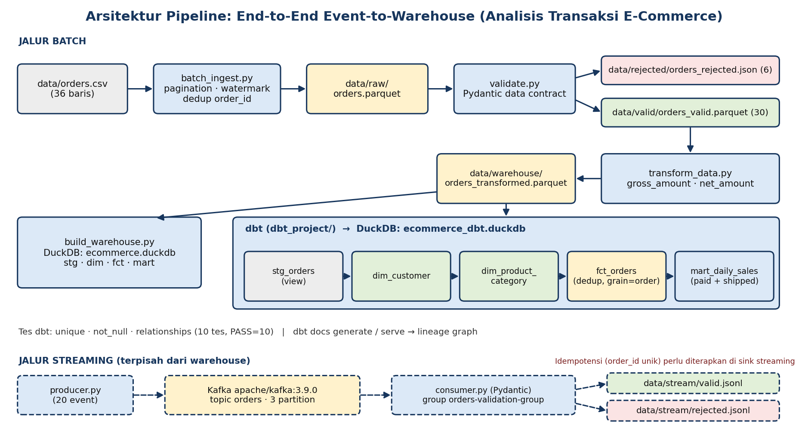
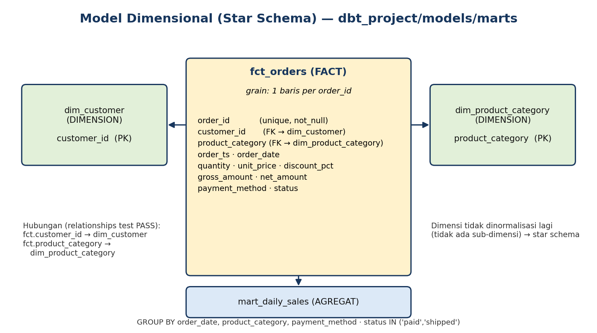

# End-to-End Event-to-Warehouse Pipeline: Analisis Transaksi E-Commerce

Mini project praktikum **Data Processing Workflow** (D4 Sains Data Terapan, PENS).
Pipeline ini membaca transaksi e-commerce, memvalidasi dengan data contract, mengalirkan event lewat Kafka ke sink yang idempoten,
mentransformasi, lalu membentuk data warehouse di DuckDB yang dikelola dbt.

**Penulis:** Syavikarani Cahya Putri (NRP 3324600054, Sains Data Terapan B)

## 1. Arsitektur singkat

```
JALUR BATCH
orders.csv -> batch_ingest.py (pagination, retry/backoff, watermark)
           -> data/raw/orders.parquet -> validate.py (Pydantic, audit rekonsiliasi)
           -> data/valid/orders_valid.parquet (30) + data/rejected/orders_rejected.json (6)
           -> transform_data.py -> data/warehouse/orders_transformed.parquet
           -> build_warehouse.py (DuckDB)  dan  dbt (stg -> dim -> fct -> mart)
           -> audit_pipeline.py (rekonsiliasi sumber -> warehouse)

JALUR STREAMING (terpisah)
producer.py -> Kafka (topic orders, 3 partition) -> consumer.py (Pydantic)
            -> sink idempoten data/stream/stream_orders.duckdb (PRIMARY KEY order_id)
            -> jejak audit: valid.jsonl / duplicates.jsonl / rejected.jsonl
```

Diagram lengkap: [pipeline_architecture.png](../pipeline_architecture.png); model dimensional: [star_schema.png](../star_schema.png).





## 2. Struktur folder

```
data_processing_miniproject/
├── data/
│   ├── orders.csv              # dataset sumber (36 baris, sebagian sengaja tidak valid)
│   ├── raw/                    # orders.parquet + ingestion_log.jsonl (hasil ingestion)
│   ├── valid/ rejected/        # hasil validasi batch + validation_audit.json
│   ├── stream/                 # sink Kafka (DuckDB) + jejak jsonl
│   ├── benchmark/              # hasil benchmark & eksperimen skew (csv)
│   └── warehouse/              # parquet transformasi, DuckDB
├── scripts/
│   ├── contract.py             # data contract bersama (batch + streaming)
│   ├── retry_utils.py          # retry + exponential backoff
│   ├── stream_sink.py          # sink idempoten (ON CONFLICT DO NOTHING)
│   ├── check_data.py  batch_ingest.py  check_parquet.py
│   ├── validate.py    producer.py      consumer.py      send_duplicate_event.py
│   ├── transform_data.py  benchmark.py  data_skew.py
│   └── build_warehouse.py  check_warehouse.py  audit_pipeline.py
├── tests/                      # pytest: unit + integration (Kafka)
├── dbt_project/                # models/staging, models/marts, tests/ (singular test)
├── docs/                       # evidence/ (log eksekusi nyata), demo_notes.md (skenario demo)
├── docker-compose.yml          # Kafka (apache/kafka:3.9.0, port 9092)
├── requirements.txt  requirements-dev.txt  .env.example  ruff.toml  pytest.ini
└── README.md
```

## 3. Prasyarat

- Python 3.10+ (diuji dengan 3.10.0)
- Docker dan Docker Compose (diuji: Docker 29.5.2, Compose v5.1.3); Docker Desktop harus berjalan sebelum `docker compose up`
- Windows PowerShell (perintah di bawah memakai sintaks PowerShell; di Linux/macOS aktifkan venv dengan `source .venv/bin/activate`)
- Versi library yang diuji: pandas 2.3.3, polars 2.0.0, duckdb 1.5.6, pydantic 2.14.1, kafka-python 3.0.11, dbt-core 1.12.6, dbt-duckdb 1.11.0, pytest 9.1.1

## 4. Instalasi dan konfigurasi

Jalankan dari folder `data_processing_miniproject/`:

```powershell
python -m venv .venv
.\.venv\Scripts\Activate.ps1
python -m pip install --upgrade pip
pip install -r requirements-dev.txt      # runtime + pytest + ruff (requirements.txt = runtime saja)
python -c "import pandas, pyarrow, pydantic, polars, duckdb; print('Library utama berhasil diimpor')"
```

Konfigurasi memakai environment variable opsional (lihat `.env.example`); tanpa pengaturan, nilai bawaan dipakai.
Tidak ada password, token, atau API key di project ini.

| Variabel | Bawaan | Fungsi |
|----------|--------|--------|
| `KAFKA_BOOTSTRAP_SERVERS` | `localhost:9092` | alamat broker |
| `KAFKA_TOPIC` | `orders` | nama topic |
| `KAFKA_GROUP_ID` | `orders-validation-group` | consumer group |

Folder keluaran (`data/raw`, `data/valid`, `data/rejected`, `data/stream`, `data/warehouse`, `data/benchmark`) dibuat otomatis oleh script.

## 5. Menjalankan pipeline (urut)

| # | Tahap | Perintah | Hasil yang diharapkan |
|---|-------|----------|-----------------------|
| 1 | Periksa dataset | `python scripts/check_data.py` | 36 baris, 9 kolom; 1 nilai kosong di `customer_id`, 1 di `order_ts`; status: paid 25, shipped 8, cancelled 1, refunded 1, pending 1 |
| 2 | Batch ingestion | `python scripts/batch_ingest.py --source data/orders.csv --out data/raw --page-size 10` | Page 1-3 = 10 record, Page 4 = 6 record; total unik 36; `orders.parquet`, `watermark.json`, `ingestion_log.jsonl` terbentuk |
| 3 | Uji jalan ulang | jalankan perintah tahap 2 sekali lagi | "Record ditambahkan: 0", total unik tetap 36 |
| 3b | Uji retry (simulasi) | `python scripts/batch_ingest.py --simulate-failures 2` | log: percobaan 1 gagal -> retry 1 detik, percobaan 2 gagal -> retry 2 detik, percobaan 3 sukses |
| 4 | Periksa Parquet | `python scripts/check_parquet.py` | 36 record, tipe data terjaga |
| 5 | Validasi (data contract) | `python scripts/validate.py` | Valid 30, Rejected 6, "Rekonsiliasi OK"; rekap penyebab penolakan; `validation_audit.json` |
| 6 | Kafka | `docker compose up -d` lalu `docker compose ps` | container `dpw-kafka` berstatus healthy |
| 7 | Producer | `python scripts/producer.py` | 20 event terkirim dengan partition dan offset |
| 8 | Uji duplikasi event | `python scripts/send_duplicate_event.py` | 2 event `TEST-DUPLICATE-001` terkirim (offset berurutan) |
| 9 | Consumer + sink idempoten | `python scripts/consumer.py` | duplikat dilaporkan "DUPLIKAT (diabaikan)"; baris di sink = jumlah `order_id` unik |
| 10 | Transformasi | `python scripts/transform_data.py` | 30 baris; `gross_amount = quantity x unit_price`, `net_amount = gross_amount x (1 - discount_pct)` |
| 11 | Benchmark Pandas vs Polars | `python scripts/benchmark.py` | median waktu per ukuran data; `data/benchmark/benchmark_results.csv` |
| 12 | Eksperimen data skew | `python scripts/data_skew.py` | distribusi + median waktu `group_by`; `data/benchmark/skew_results.csv` |
| 13 | Warehouse DuckDB | `python scripts/build_warehouse.py` lalu `python scripts/check_warehouse.py` | stg 30, dim_customer 25, dim_product_category 4, fct 30, mart_daily_sales 28 baris |
| 14 | Audit end-to-end | `python scripts/audit_pipeline.py` | 9/9 cek lulus (lihat bagian 8) |

Tahap 7-9 dapat dijalankan dalam satu terminal secara berurutan: producer mengirim ke topic, consumer membaca sampai 15 detik tanpa pesan baru lalu berhenti.
Untuk demo bersih tanpa riwayat lama, gunakan group baru: `$env:KAFKA_GROUP_ID = "demo-1"`.

### dbt

```powershell
dbt debug --project-dir dbt_project --profiles-dir dbt_project
dbt run   --project-dir dbt_project --profiles-dir dbt_project     # PASS=5
dbt test  --project-dir dbt_project --profiles-dir dbt_project     # PASS=14
dbt docs generate --project-dir dbt_project --profiles-dir dbt_project
dbt docs serve    --project-dir dbt_project --profiles-dir dbt_project   # http://localhost:8080
```

Model dbt: `stg_orders` (view) -> `dim_customer`, `dim_product_category` -> `fct_orders` -> `mart_daily_sales` (table).
Tes: `unique`, `not_null`, `relationships`, `accepted_values` (status), dan satu tes singular
(`dbt_project/tests/assert_amounts_match_formula.sql`) yang memverifikasi rumus gross/net amount.

### Pengujian otomatis

```powershell
python -m pytest -q          # 34 tes unit + 1 integration (Kafka)
ruff check scripts tests     # lint
```

Tes `tests/test_kafka_integration.py` memakai broker sungguhan dan otomatis di-skip bila Docker/Kafka belum berjalan.
Hasil terakhir (broker aktif): **35 passed**.

## 6. Data contract (ringkas)

| Field | Aturan |
|-------|--------|
| order_id, customer_id, product_category, payment_method | wajib, tidak kosong |
| order_ts | datetime valid |
| quantity | integer > 0 (pecahan seperti 2.5 ditolak, tidak dibulatkan diam-diam) |
| unit_price | >= 0 |
| discount_pct | 0 sampai 1 |
| status | `paid`, `shipped`, `cancelled`, `refunded` |
| field tambahan | ditolak (`extra="forbid"`) |

Record yang melanggar aturan dipisahkan ke file rejected beserta `reason_code` dan pesan error Pydantic.
Kontrak yang sama (`scripts/contract.py`) dipakai jalur batch dan streaming.

Rekap penolakan pada data sumber (dari `validation_audit.json`): 6 record ditolak, masing-masing 1 untuk
`quantity:greater_than`, `unit_price:greater_than_equal`, `discount_pct:less_than_equal`, `status:literal_error`,
`customer_id:missing`, `order_ts:missing`. Tidak ada satu penyebab yang dominan.

## 7. Streaming: konsep dan jaminan yang sebenarnya

- **Partition**: topic `orders` dibagi 3 partition. Key pesan = `order_id`, sehingga event dengan `order_id` sama selalu masuk partition yang sama dan urutannya terjaga. Partition juga unit paralelisme consumer.
- **Consumer group**: consumer dengan `group_id` yang sama berbagi partition (satu partition dibaca satu anggota). Group berbeda membaca seluruh topic sendiri-sendiri.
- **Offset**: nomor urut pesan dalam partition. Consumer menyimpan offset yang sudah diproses (`commit`) per group; saat restart, pembacaan lanjut dari offset terakhir. Di project ini `enable_auto_commit=False` dan commit dilakukan **setelah** penulisan ke sink.
- **At-least-once vs exactly-once**: commit setelah proses berarti crash di antara proses dan commit membuat pesan terbaca lagi (at-least-once, duplikat mungkin). Exactly-once memerlukan transaksi Kafka atau sink yang idempoten. Project ini **tidak** mengklaim exactly-once end-to-end.
- **Idempotensi di sink**: sink berupa tabel DuckDB `stream_orders` dengan `PRIMARY KEY (order_id)`. Penulisan satu event adalah satu pernyataan atomik `INSERT ... ON CONFLICT DO NOTHING`. Event yang terkirim/terbaca ulang tidak menambah baris (kebijakan: *first-write-wins* per `order_id`). Producer idempotence Kafka saja tidak cukup, karena tidak mencegah duplikat yang dikirim aplikasi dua kali atau redelivery ke consumer.
- **Crash recovery**: jika proses mati setelah tulis sink tetapi sebelum commit offset, pesan dikirim ulang dan sink menolaknya sebagai duplikat (diuji di `tests/test_stream_sink.py::test_replay_after_crash_is_idempotent`).
- **Batas jaminan**: efek bisnis di sink (`stream_orders`) bebas duplikat per `order_id`. File `valid.jsonl`/`duplicates.jsonl`/`rejected.jsonl` hanyalah jejak audit tambahan yang ditulis setelah sink; bila proses mati di antara keduanya, jejak bisa kurang satu baris, sedangkan sink tetap benar. Event berbeda dengan `order_id` sama (misalnya koreksi) diabaikan oleh kebijakan first-write-wins; menanganinya memerlukan versi event atau upsert terkontrol.

**Bukti eksekusi** (broker Kafka lokal, `docs/evidence/kafka_idempotency_run.txt`): consumer dengan group baru membaca 64 pesan dari topic (termasuk event yang dikirim ulang dari run-run sebelumnya) -> 21 baris baru, 43 duplikat diabaikan, 0 rejected; sink berisi 21 baris dengan 21 `order_id` unik, `TEST-DUPLICATE-001` hanya 1 baris. Setelah duplikat dikirim lagi dan consumer dijalankan ulang: 2 pesan dibaca, 2 duplikat, sink tetap 21 baris.

## 8. Data quality dan audit

- `validate.py` menulis `data/rejected/validation_audit.json` dan gagal (exit code 1) bila **total input != valid + rejected**. Hasil: 36 = 30 + 6.
- `audit_pipeline.py` memeriksa dari sumber sampai warehouse (9 cek, semuanya lulus pada run terakhir):
  1. `order_id` unik di sumber = jumlah baris raw (36)
  2. raw = valid + rejected (36 = 30 + 6)
  3. valid dan rejected tidak beririsan
  4. `fct_orders` = jumlah `order_id` valid unik (30)
  5. `order_id` rejected tidak ada di `fct_orders`
  6. `fct_orders.order_id` unik
  7. `gross_amount`/`net_amount` sesuai rumus
  8. tidak ada foreign key yatim ke `dim_customer` dan `dim_product_category`
  9. total `mart_daily_sales` = jumlah `net_amount` berstatus paid+shipped di fakta (3412.02)
- Definisi penjualan di mart: hanya status `paid` dan `shipped`.
- Watermark berbasis `order_ts`: record dengan `order_ts` tidak valid selalu ikut diproses ulang agar bisa diaudit (lalu dideduplikasi per `order_id`, sehingga tidak menambah baris). Konsekuensinya, record terlambat yang `order_ts`-nya lebih lama dari watermark tidak akan terambil oleh mode incremental.

## 9. Retry dan exponential backoff

`scripts/retry_utils.py`: `with_retry(...)` mengulang hanya untuk error sementara (`TransientSourceError`, `ConnectionError`, `TimeoutError`),
dengan jeda `min(base_delay * 2^(percobaan-1), max_delay)` = 1s, 2s, 4s, ... dan batas `--max-attempts` (bawaan 4).
Error permanen (misalnya `ValueError`) langsung dilempar tanpa retry. `--simulate-failures N` membuat N pemanggilan pertama gagal
(setara HTTP 503) sehingga retry dapat didemokan; sumber tetap CSV lokal, jadi ini simulasi, bukan retry HTTP sungguhan.
Retry hanya membungkus pembacaan halaman (operasi baca tanpa efek samping), sehingga tidak dapat menggandakan atau menghilangkan data;
diverifikasi di `tests/test_retry.py` (urutan baris setelah kegagalan sama dengan sumber).

Contoh log nyata (`--simulate-failures 2`):

```
Mengambil halaman 1...
  Percobaan 1/4 gagal (503 Service Unavailable (simulasi)); retry dalam 1 detik...
  Percobaan 2/4 gagal (503 Service Unavailable (simulasi)); retry dalam 2 detik...
Page 1: 10 record
```

## 10. Benchmark Pandas vs Polars

Pekerjaan sama untuk ketiga implementasi: baca Parquet -> parse `order_ts` -> hitung gross/net -> total `net_amount` per (`product_category`, tanggal).
Hasil ketiganya diperiksa setara sebelum waktu dicatat. 2 warm-up, 7 pengulangan, **median** (detik). Data 30 baris adalah data asli;
ukuran lain direplikasi dari data asli dengan `order_id` unik. Lingkungan: Python 3.10.0, pandas 2.3.3, polars 2.0.0, Windows 11, AMD64 (AuthenticAMD Family 25).

| Baris | Pandas | Polars eager | Polars lazy |
|------:|-------:|-------------:|------------:|
| 30 | 0.0071 | 0.0029 | 0.0074 |
| 10.000 | 0.0831 | 0.0114 | 0.0089 |
| 100.000 | 0.6153 | 0.0611 | 0.0551 |
| 1.000.000 | 6.3312 | 0.6077 | 0.4218 |

Pembacaan: pada 30 baris selisih hanya beberapa milidetik dan berada dalam rentang noise (lihat kolom min/max di `benchmark_results.csv`),
sehingga tidak ada pemenang yang bermakna; pengukuran awal 30 baris sebelumnya (Pandas 0,266 s vs Polars lazy 0,138 s, satu kali ukur)
tidak dapat direproduksi dan tidak dipakai sebagai kesimpulan. Pada 10 ribu baris ke atas, Polars lebih cepat pada workload ini
(sekitar 7-10x pada eager, sekitar 15x pada lazy untuk 1 juta baris), dan lazy sedikit lebih cepat daripada eager. Hasil ini berlaku untuk
workload, mesin, dan versi di atas, bukan klaim umum bahwa Polars selalu lebih cepat.

Catatan metodologi: versi awal memakai agregasi per kategori saja; di sana parse `order_ts` tidak mempengaruhi hasil sehingga optimizer lazy
membuangnya dan keunggulan lazy tampak berlebihan. Kunci tanggal ditambahkan agar kerja yang diukur benar-benar setara.

**Lazy vs eager**: `scan_parquet(...).collect()` membangun rencana kueri dulu lalu dioptimasi (projection pushdown membaca hanya kolom yang dipakai,
penghapusan komputasi tak terpakai); `read_parquet` langsung memuat semua kolom ke memori. Pandas selalu eager.

## 11. Eksperimen data skew

1. **Data asli** (tugas): baris customer dominan `C001` digandakan -> 30 baris menjadi 170 baris, pangsa terbesar 13,3% -> 23,5%.
   Jumlah baris berubah, sehingga selisih waktunya (0,0033 s vs 0,0027 s) bukan efek skew murni dan tidak disimpulkan.
2. **Terkontrol** (1 juta baris, 10.000 customer, jumlah baris sama): median `group_by` customer, 7 pengulangan.

| Distribusi | Pangsa customer terbesar | Pandas (s) | Polars (s) |
|------------|-------------------------:|-----------:|-----------:|
| Seragam | 0,01% | 0,1045 | 0,0197 |
| Skew 50% | 50,0% | 0,1082 | 0,0209 |
| Skew 90% | 90,0% | 0,1069 | 0,0223 |

Pada mesin tunggal dan data 1 juta baris, skew tidak menambah waktu `group_by` secara berarti (Pandas +2-4%, Polars +6-13%, selisih kecil dan tidak diuji signifikansinya).
Skew terutama merugikan pada pemrosesan terdistribusi (satu partisi/worker kelebihan beban) atau agregasi berstate besar; itu tidak diuji di sini,
dan tidak ada uji kehabisan memori (OOM) yang dilakukan atau diklaim.
Mitigasi yang relevan jika data membesar: proyeksi kolom sebelum agregasi, agregasi parsial per chunk lalu gabung, pemrosesan bertahap,
`scan_parquet` lazy agar tidak memuat seluruh data, dan salting key untuk sistem terdistribusi.

## 12. Desain warehouse

- **Grain** `fct_orders`: satu baris per `order_id`. Dimensi: `dim_customer` (key `customer_id`) dan `dim_product_category` (key `product_category`). Mart `mart_daily_sales`: per tanggal x kategori x metode pembayaran.
- **Star vs snowflake**: star schema menyimpan dimensi denormalisasi (satu join dari fakta ke tiap dimensi) sehingga kueri sederhana dan cepat; snowflake menormalisasi dimensi menjadi beberapa tabel (hemat redundansi, tetapi lebih banyak join). Project ini memakai star karena dimensinya kecil dan tidak berjenjang.
- **Incremental model**: dibutuhkan saat data bertambah terus dan full refresh terlalu mahal/lambat. Model `marts` di sini memakai `table` (full refresh) karena data hanya 30 baris; untuk volume besar, `fct_orders` sebaiknya `incremental` dengan `unique_key=order_id`.

## 13. Pemecahan masalah umum

| Gejala | Penyebab / solusi |
|--------|-------------------|
| `failed to connect to the docker API` | Docker Desktop belum berjalan; buka Docker Desktop lalu ulangi `docker compose up -d` |
| `NoBrokersAvailable` | Kafka belum healthy; tunggu `docker compose ps` menunjukkan healthy, cek port 9092 |
| Consumer membaca 0 pesan | group sudah men-commit semua offset; pakai group baru (`$env:KAFKA_GROUP_ID = "demo-2"`) |
| `File tidak ditemukan: data/...` | tahap sebelumnya belum dijalankan; ikuti urutan tabel bagian 5 dari direktori `data_processing_miniproject/` |
| `dbt` error path profil | jalankan dari `data_processing_miniproject/` dan sertakan `--project-dir dbt_project --profiles-dir dbt_project` |
| Error encoding saat dbt/Python di path berisi karakter non-ASCII | gunakan PowerShell, bukan Git Bash; atau `$env:PYTHONIOENCODING = "utf-8"` |
| `ModuleNotFoundError` saat menjalankan script | aktifkan venv dan `pip install -r requirements-dev.txt` |

## 14. Keterbatasan yang diketahui

- Sumber ingestion adalah CSV lokal yang dibaca per halaman (simulasi REST API); tidak ada permintaan HTTP ke API eksternal. Kegagalan pada retry disimulasikan lewat parameter.
- Kafka berjalan sebagai satu broker (replication factor 1); cocok untuk praktikum, bukan produksi.
- Idempotensi sink mencakup jalur streaming ke `stream_orders`; bukan exactly-once end-to-end, dan kebijakannya first-write-wins.
- Jalur streaming belum terhubung ke warehouse dbt; warehouse dibangun dari jalur batch.
- Benchmark dan skew dijalankan di satu mesin; hasil bergantung pada perangkat keras dan versi library, serta tidak diuji signifikansi statistiknya.
- Model `marts` memakai materialisasi `table` (full refresh), belum `incremental`.
- Belum ada video demo; tidak ada orkestrasi otomatis (urutan dijalankan manual).

## 15. Pengembangan lanjutan

Penghubung jalur streaming ke warehouse, model dbt incremental, orkestrasi pipeline, versi event untuk koreksi (upsert terkontrol),
dan optimasi untuk data skala besar.
